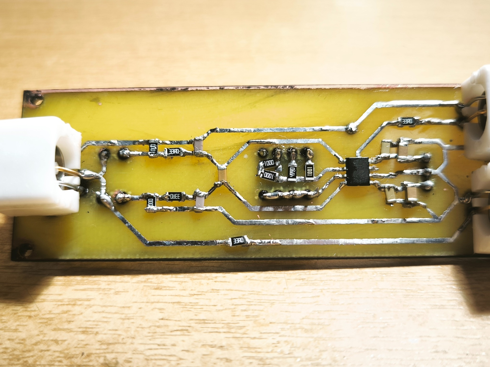

# ВПВ — 3 семестр: вихретоковый сканер

Автоматизированный экспериментальный сканер дефектов в алюминии на базе **Creality Ender-3**, измерительных катушек и **Hantek DSO2D15**. Переменное магнитное поле возбуждает вихревые токи; дефекты меняют амплитуду и фазу отклика. Цель — построить пространственную карту и оценить чувствительность разных датчиков и схем усиления.

**Состояние на 21.11.2026:** крепление и детали напечатаны, катушки намотаны, пластина с дефектами изготовлена. По сообщению автора, плата EDC-AMP V1 полностью спаяна, включая AD8421 и разъёмы. Переключатели усиления и контактные штыри расположены с обратной стороны. Электрическая работоспособность пока не подтверждена измерениями.

## Документация

- **[Текущий ход проекта — 21 ноября](docs/status-2026-11-21.md)**
- [Состояние на 18 ноября](docs/status-2026-11-18.md)
- [План экспериментов](docs/plan.md)
- [Конструкция и измерительный тракт](docs/design.md)
- [Подключение L1/L2 + EDC-AMP V1 + Hantek (векторная схема)](schematics/EDC-AMP-V1-system-connection.svg)
- [Предварительный эскиз усилителя](schematics/EDC-AMP-V1.png)
- [Экспорт разводки EasyEDA](schematics/PCB_PCB12_2026-11-16.pdf)
- [Инструкция по сборке CAD-моделей и экспорту STL](cad/README.md)

## CAD (редактируемые исходники)

- [Каркас большой катушки V1](cad/EDC_Bobbin_V1.scad)
- [Крепление Ender-3, лапка, проставки 10/20/30 мм](cad/EDC_Ender3_probe_mount_V0.scad)
- [Миниатюрные катушки V2-Air и V2-Ferrite](cad/EDC_V2_interchangeable.scad)

Модели задаются параметрически в **OpenSCAD**: STL генерируется из `.scad`. Изображения и чертежи схемы **предварительные**; перед подачей питания и запуском движений требуется проверка распиновки, зазоров и полярности.

**Ближайшая экспериментальная цель:** зарегистрировать повторяемый сигнал при проходе катушки над известной прорезью и сравнить с фоном неповреждённого металла.
