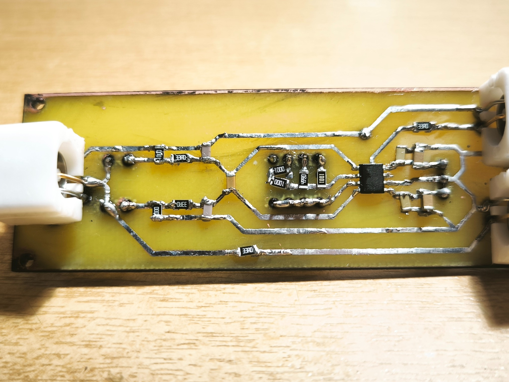

# Состояние на 21.11.2026

По сообщению автора, плата EDC-AMP V1 полностью спаяна. Переключатели усиления и контактные штыри находятся с обратной стороны платы.

Крепление и детали напечатаны, катушки намотаны, пластина с дефектами изготовлена. Следующий этап — проверка питания и соединений, затем измерение усиления и первого отклика над прорезью. Испытания собранного электрического тракта пока не подтверждены.
